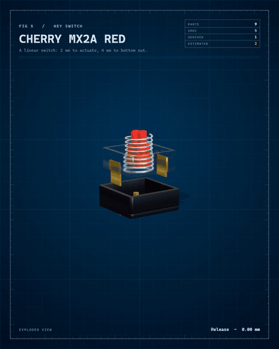
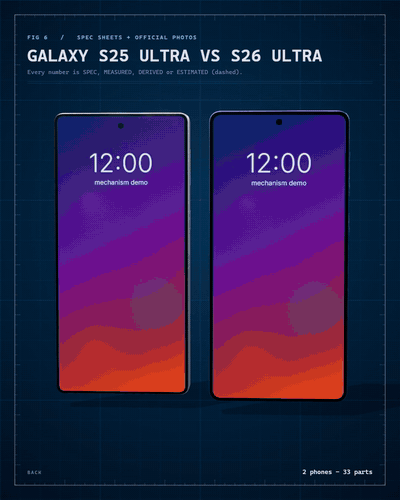

# mechanism

**Model a real object exactly, take it apart, film it.** A skill for coding agents that researches a real product or machine, writes a spec where every number says where it came from, and renders a narrated film with designed sound, an interactive viewer and a 3D model.

<p align="center"></p>
<p align="center"> </p>
<p align="center">  </p>

It does not draw what it can look up wrong. It searches, downloads the pictures and looks at them, measures them, cross-checks every derived number against a second published one, and labels the result:

| Label | Meaning |
|---|---|
| `SPEC` | Published by the maker or a datasheet. |
| `MEASURED` | Measured on an official photo, scale from a published size, error stated. |
| `DERIVED` | A formula plus a cross-check against another published number. |
| `ESTIMATED` | Nobody publishes it. Drawn dashed and said out loud. |

## One spec in, everything out

```
spec.js  ->  film (4:5, 9:16, 1:1; paper or night; stereo, synthesised sound)
         ->  clips cut from the film
         ->  interactive viewer (orbit, explode, measure, run the mechanism)
         ->  STL and GLB of the model
```

You write parts with real dimensions, the evidence behind each number and how it moves. The engine builds the scene, solves the kinematics, directs the camera, designs the sound and renders.

```js
{ id: 'ring', kind: 'ring', p: { m: 0.8, z: 60, ro: 27.4, width: 8 }, mat: 'steel-dark',
  at: [0, 0, 0], body: 'ring', explode: [0, 0, -12], conf: 'derived', claims: ['teeth', 'formula'] }
```

### A gate before rendering

```
$ node scripts/check-spec.mjs examples/hub/spec.js
  centres ring-p1: 16.000 mm (required 16.000)  ok
  mode Gear 3: 1.3333, published 1.3333  ok
PASSES
```

It fails (exit 1) when a number has no source, a DERIVED claim has no cross-check, a MEASURED one no error, an ESTIMATED one no reason; when two meshing gears are not at the centre distance their module and teeth demand; when the teeth do not interleave; or when a mode of operation does not give the ratio the maker publishes. Change one planet gear from 20 to 21 teeth and it tells you the centre distance is off by 0.8 mm.

## Examples

| | What it shows |
|---|---|
| `examples/enigma` | The Enigma I rotor stack. The wiring, notches and stepping are simulated and must reproduce the published tests: `AAAAA` becomes `BDZGO`, with rings BBB `EWTYX`, and the middle rotor double-steps `ADU > ADV > AEW > BFX`. The signal lights its path through the contacts; in the viewer you type on your keyboard. |
| `examples/rubik` | The cube as 26 pieces that really turn. The 20-move superflip must flip all 12 edges and leave the corners alone, the longest period must come out at 1,260 and the positions at 43,252,003,274,489,856,000, all read off the model. |
| `examples/k20a` | Honda K20A: an inline four with 16 valves. A crank-slider with exact kinematics; the displacement is computed from the bore and stroke (1,998 cc published), and the published firing order 1-3-4-2 must be possible with the crank (1-2-3-4 is rejected). The connecting rod and the valve timing are not published and are drawn dashed. |
| `examples/hub` | Three-speed planetary hub (Sturmey-Archer AW type). The running model gives 0.75, 1.00 and 1.333 against the published 75, 100 and 133 %. Tooth counts are derived from a forum post and cross-checked, sizes are estimated. |
| `examples/switch` | Cherry MX2A Red key switch: a press, not gears. The datasheet's three force points (30, 45, 100 cN) cannot come from one linear spring, and the film plots that instead of hiding it. |
| `examples/s25-vs-s26` | Galaxy S25 Ultra against S26 Ultra at the same scale, measured on the official renders (five separate lens rings against one pill, titanium against aluminum, corners 5.6 against 7 mm). Interiors are not drawn: no readable photo, so the film says so. |
| `examples/phones` | POCO X8 Pro Max against Galaxy S26 Ultra at the same scale, measured on official photos with OpenCV. |
| `examples/rpi4` | Raspberry Pi 4B from the official datasheet drawing. |
| `examples/instruments` | A catalog photo turned into 3D plates, with the limits stated (a single photo gives no millimetres). |
| `examples/backpressure` | An idea from a repo built as a working machine. |

## Use it as a Claude Code skill

```bash
# macOS / Linux
git clone https://github.com/DiegoLopez0208/mechanism ~/.claude/skills/mechanism
# Windows (PowerShell)
git clone https://github.com/DiegoLopez0208/mechanism $env:USERPROFILE.claudeskillsmechanism
```

Then ask your agent for an exploded view of something real ("model a mechanical keyboard switch exactly, with its sources"): it researches, writes the spec, runs the gate and renders. `node scripts/new.mjs <name>` is the starting point for a new object.

## Quickstart

Needs Node 22+, Edge or Chrome, `ffmpeg`, and `uv` (only to measure photos). Nothing to install to render.

```bash
node scripts/check-spec.mjs examples/hub/spec.js                    # the gate
node scripts/probe.mjs "examples/hub/index.html?explore" out/probe  # mouse-driven check of the viewer
node scripts/render.mjs examples/hub/index.html --blur 3 --out out/hub.mp4
node scripts/render.mjs examples/hub/index.html --theme night --aspect 9:16 --out out/hub-night-916.mp4
node scripts/render.mjs examples/hub/index.html --from 13 --to 21 --out out/hub-clip.mp4
node scripts/render.mjs examples/hub/index.html --export glb --e 1 --out out/hub.mp4   # also: --export stl
```

Open `examples/hub/index.html?explore` in a browser for the viewer (add `&theme=night`). In `examples/enigma/index.html?explore` the viewer takes your keyboard: type letters and the machine enciphers them with the published rules (Esc clears). The landing page is `index.html`.

To make a new one, copy `examples/hub`, write the research into `spec.js`, and run the gate until it passes. `SKILL.md` has the method.

## What is inside

| File | Role |
|---|---|
| `kit/parts.js` | Parametric parts with real dimensions: involute gears, internal ring gears, chain sprockets, bearings with balls, springs, flanges, housings, stems. |
| `kit/enigma.js` | The Enigma I logic (wiring, notches, double stepping, plugboard), pure: runs in Node and is checked against published vectors. |
| `kit/kin.js` | Gear-train kinematics (Willis relations), tooth phase so the teeth really interleave, centre-distance and assembly checks. Pure: runs in Node. |
| `kit/spec-core.js`, `kit/spec.js` | Validate a spec; compile it to scene, director, panels and sound. |
| `kit/gl.js`, `kit/figure.js` | three.js stage (physical materials, glass, depth of field, ambient occlusion, bloom) and the figure engine. |
| `kit/sound.js`, `kit/samples.js` | Sound per material and size, stereo, built from CC0 recordings (keys, metal, glass, plastic impacts). Tooth ticks are the real tooth passes of the running gears; the engine fires in its real order. |
| `kit/cube.js` | The Rubik cube as 26 cubies, pure: runs in Node and is checked against the published facts. |

## Limits, stated plainly

- Mechanisms: gear trains (one degree of freedom), presses and slides, rotor ciphers (Enigma), crank-slider engines and the Rubik cube. No general linkages or cam followers beyond the engine yet.
- The hub's power path per mode is simplified: pawls and clutch are not modelled, and the film says so.
- Interiors need photos or drawings. Without them they are estimated and dashed.
- A single photo gives no millimetres: it needs a published size, a ruler or a datasheet.
- Rendering is heavy: about 6 minutes per minute of video.
- The sources can be wrong too. The spec keeps them next to each claim so you can check, and notes where a page refused to be read.
