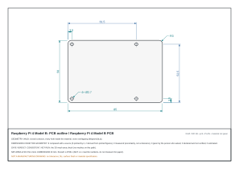

<h1 align="center">mechanism</h1>

<h3 align="center">Every number cites its source, or it does not render.</h3>

<p align="center">A skill for coding agents. Ask for an exploded view or a drawing of something real<br>
and it researches the object, writes a spec where every number names its source,<br>
runs a gate that refuses what does not add up, and outputs a film, a viewer, a 3D model or a dimensioned SVG.</p>

<p align="center">
  <a href="https://diegolopez0208.github.io/mechanism/"><b>Live page</b></a> &middot;
  <a href="https://diegolopez0208.github.io/mechanism/#touch">Try the viewers</a> &middot;
  <a href="#install">Install</a> &middot;
  <a href="#the-gate">The gate</a> &middot;
  <a href="#draft-dimensioned-drawings">Draft</a> &middot;
  <a href="#examples">Examples</a>
</p>

<p align="center">
  
  
  
  
  <a href="https://www.claudepluginhub.com/plugins/diegolopez0208-mechanism?ref=badge"></a>
</p>

<p align="center"></p>
<p align="center">
  
  
  
</p>

```
/plugin marketplace add DiegoLopez0208/mechanism
/plugin install mechanism@mechanism
```

<p align="center"><sub>Then ask: <i>"Use mechanism to model a mechanical keyboard switch from its published sources."</i> &middot; <a href="#install">Other ways to install</a></sub></p>

## Technical film collection

The [live gallery](https://diegolopez0208.github.io/mechanism/#examples) contains
34 films: 22 Studio assemblies, six Workflow processes and six Paper drawings.
The revised Studio additions are 12-second native 3D construction studies with
source notes and explicit estimates. Rubik, Enigma and Cherry remain in the
collection. [Production and quality notes](docs/technical-quality.md) describe
the render paths, limits and repeatable checks.

## What it does

Ask your agent for an exploded view or a drawing of something real: a machine, a chip, a board, or **software** (a file format, a protocol, an algorithm's output).

1. **Researches.** Opens datasheets, drawings, CAD files and teardowns, looks at the pictures, measures them.
2. **Writes a spec.** Parts with real dimensions, how they move, and the evidence behind every number.
3. **Runs the gate.** The model is compared with what is published. A spec that does not add up is not rendered, and one that does is told how far it was really checked.
4. **Renders.** A film (4:5, 9:16 or 1:1, with real recorded sound), a live viewer, an STL / GLB, or, for flat parts, an SVG drawing at true scale.

Every number carries its class:

| Class | Meaning |
|---|---|
| `SPEC` | Printed by a source someone else can open: a datasheet, a drawing, a CAD file. |
| `USER` | Given by the person who asked. Drawn and counted, never verified. |
| `MEASURED` | Measured, or read off a figure or photo: method and uncertainty stated (an uncertainty, never a tolerance). |
| `DERIVED` | Computed from other numbers, with a cross-check against a second one. |
| `ESTIMATED` | Nobody publishes it. Drawn dashed and said out loud. |

## The gate

```
$ node scripts/check-spec.mjs examples/hub/spec.js
...
  centres sun-p1: 16.000 mm (required 16.000)  ok
  mode Gear 2: 1.0000  published 1  ok
  mode Gear 3: 1.3333  published 1.3333333333333333  ok
  mode Gear 1: 0.7500  published 0.75  ok
provenance: 3 independent, 0 same source as the inputs, 0 with no sourced inputs, ...
verdict: VERIFIED   3 reproduced, 4 estimated, 0 unchecked published comparisons
```

Break something and it says exactly what:

```
$ node scripts/check-spec.mjs examples/k20a/spec.js      # firing order changed to 1-2-3-4
ERROR  firing order 1-2-3-4: cylinder 3 would have to fire at 360 degrees and its crank throw is at 180 (not possible with that crankshaft)
ERROR  firing order 1-2-3-4: cylinder 4 would have to fire at 540 degrees and its crank throw is at 0 (not possible with that crankshaft)
ERROR  phase Firing order: the model gives 1-2-3-4 and the published one is 1-3-4-2

DOES NOT PASS: 3 error(s)
```

It fails (exit 1) when a number has no source, a DERIVED claim has no cross-check, a MEASURED one no error, an ESTIMATED one no reason; when two meshing gears are not at the centre distance their module and teeth demand; when a mode does not give the ratio the maker publishes; when a cipher disagrees with a published test; when a firing order is impossible with the crank; when a drawn dimension differs from the figure it cites. It also refuses what a template leaves behind: placeholder addresses (`example.com/.org/.net` and their subdomains, any `.invalid`, `.test` or `.example` host, `localhost`), `TODO`, non-finite or non-positive sizes, a variable with no claim.

**The verdict says how far it was really checked:**

- `VERIFIED`: every published figure matched, none is pending, and **at least one check is independent**: the published figure's sources share nothing with the sources of the inputs the model computed it from.
- `CONSISTENT`: everything matched, but no check is independent. The checks share their source with the inputs, or compare a drawn dimension with the very figure it was drawn from, or have inputs the gate cannot trace. The gate says which.
- `NOTHING CHECKED`: nothing was compared; a description, not a verification. `INCOMPLETE`: a comparison is pending. `DOES NOT PASS`: any mismatch.

The full contract, and why four examples went from VERIFIED to CONSISTENT when it was tightened: [`docs/draft-evidence.md`](docs/draft-evidence.md). `--json verdict.json` writes the report (verdict, errors, spec and kit SHA-256, Node version, date); `node scripts/registry.mjs` writes [`docs/registry.html`](docs/registry.html) and a badge per object straight from the gate.

## Draft: dimensioned drawings

<p align="center"></p>

For flat parts (plates, brackets, flanges, PCB outlines, panels with holes and slots) the spec declares the geometry in mm and Draft exports an engineering SVG: at **1:1** (1 unit = 1 mm, the document's size in mm) or on an **A4 sheet** with its scale written on it. Circles and arcs stay exact, every dimension is a value of the geometry, and its colour says its evidence: teal printed by the source, blue derived, violet measured, ink given by the user or not verified, amber estimated. Every file says **NOT A MANUFACTURING DRAWING**: there are no tolerances, fits or finish.

```sh
node scripts/check-spec.mjs examples/rpi4-board/spec.js                          # CONSISTENT: one maker's PDF and DXF
node scripts/export-svg.mjs examples/rpi4-board/spec.js --mode geometry-1to1 --out work/svg
```

The Raspberry Pi 4 above comes from Raspberry Pi's own drawing (cited, not copied): 85 x 56 mm, R3 corners, four Ø2.7 holes on 58 x 49 mm. Draft is also a plugin on its own (1.6 MB, no 3D): [`plugins/mechanism-draft`](plugins/mechanism-draft/README.md).

**Tested by strangers.** Fresh agent sessions with only the plugin installed were given one sentence each. In the first test (Draft 0.4) the drawings were exact, but a plate whose only source was the request passed as VERIFIED, a narrow part's SVG cut its manufacturing warning, and the skill was not picked unless named; all three were fixed. Afterwards, unprompted, it picked the skill in 3 of 3 sessions (a plate, a flange, an Arduino Uno outline from Arduino's CAD files), declared the user's numbers as USER, and reported CONSISTENT. Three runs, not a rate. When asked for a "final drawing with industrial tolerances" from a photo with no dimensions, the agent asked for measurements instead of inventing a drawing.

## Examples

Every example is a film, a live viewer (`examples/<name>/index.html?explore`) and a model. The verdict is the gate's, today.

| | What its model had to reproduce | Verdict |
|---|---|---|
| [`enigma`](examples/enigma) | The Enigma I rotor stack. Wiring, notches and stepping are simulated and must match the published tests: `AAAAA` becomes `BDZGO`, with rings BBB `EWTYX`, and the middle rotor double-steps `ADU > ADV > AEW > BFX`. In the viewer you type on your keyboard. | CONSISTENT: wiring and vectors are on one page |
| [`rubik`](examples/rubik) | 26 cubies that really turn, with no permutation tables. The 20-move superflip flips all 12 edges, the longest period is 1,260 and the positions count 43,252,003,274,489,856,000. | CONSISTENT: inputs and figures on one page |
| [`k20a`](examples/k20a) | Honda K20A, inline four with 16 valves. Exact crank-slider kinematics: displacement from bore and stroke (1,998 cc published), and the firing order 1-3-4-2 must be possible with the crank. Rod and valve timing are not published and are dashed. | CONSISTENT: bore, stroke and displacement from one page |
| [`react`](examples/react) | **Software** in motion: what a click does to a React page. A model written from the published reconciliation rules must predict what the real React 18.3.1 touches: **1** of 8 DOM nodes, nothing created or removed (measured with a MutationObserver in jsdom). | VERIFIED |
| [`lock`](examples/lock) | A pin tumbler lock, cut open, with a Kwikset KW1 key. Key pin plus cut depth is .501 in for all six heights; the right key puts all five splits on the shear line, a wrong one leaves a pin across it. | CONSISTENT: every figure from one keying table |
| [`winrar`](examples/winrar) | **Software** doing its job: WinRAR 7.23 packed 119 characters into 49 bytes of DEFLATE; a decoder written only from RFC 1951 writes the text back, and the CRC-32, Node zlib and WinRAR must agree. | VERIFIED |
| [`rar5`](examples/rar5) | **Software** taken apart: the 87 bytes WinRAR writes for a one-file archive, every one explained. A model from the RAR5 format rebuilds them byte for byte, and the real `UnRAR.exe` accepts what the model built. | VERIFIED |
| [`mos6502`](examples/mos6502) | The 6502 in its 40-pin DIP: address and data pins counted against the published buses, the 64 KB space, 105 undefined opcodes, leads against the DIP standard. | VERIFIED |
| [`rtx4090`](examples/rtx4090) | GeForce RTX 4090 Founders Edition: TFLOPS, fillrates, 1,008 GB/s and 24 GB, each computed from the published cores, clocks, bus and data rate. The inside is not published and is dashed. | VERIFIED |
| [`hub`](examples/hub) | Three-speed planetary hub (Sturmey-Archer AW type): the running gears give 0.75, 1.00 and 1.333 against the published 75, 100 and 133 %. | VERIFIED |
| [`switch`](examples/switch) | Cherry MX2A Red: a press, not gears. The datasheet's three force points cannot come from one linear spring, and the film plots that instead of hiding it. | CONSISTENT: travel compared with the claim it was drawn from |
| [`rpi4-board`](examples/rpi4-board) | Raspberry Pi 4 Model B outline and mounting holes, from the maker's PDF and DXF (Draft). | CONSISTENT: one maker, one design |
| [`s25-vs-s26`](examples/s25-vs-s26), [`phones`](examples/phones) | Phones at the same scale, measured on official renders and photos. | figures (no spec) |
| [`rpi4`](examples/rpi4), [`backpressure`](examples/backpressure) | A board in 3D from its datasheet drawing; an idea from a repository built as a working machine. | figures (no spec) |

CONSISTENT is not a failure: the model agrees with its source in every figure compared. It means a wrong source would agree too. Synthetic demonstrations (`demo-plate`, `demo-flange`, `demo-section`) are NOTHING CHECKED on purpose.

## Install

As a Claude Code plugin (Claude Code 2.1.275 or later):

```
/plugin marketplace add DiegoLopez0208/mechanism
/plugin install mechanism@mechanism            # everything: Studio, Workflow, Paper, Draft
/plugin install mechanism-draft@mechanism      # only the drawings (SVG, Paper sheets), 1.6 MB, no 3D
```

Or by hand, as a plain skill:

```bash
# macOS / Linux: a sparse clone (no site media, little history; tests include compact golden frames)
git clone --depth 1 --filter=blob:none --sparse https://github.com/DiegoLopez0208/mechanism ~/.claude/skills/mechanism
git -C ~/.claude/skills/mechanism sparse-checkout set kit scripts examples data tools tests references
# Windows (PowerShell)
git clone --depth 1 --filter=blob:none --sparse https://github.com/DiegoLopez0208/mechanism $env:USERPROFILE\.claude\skills\mechanism
git -C $env:USERPROFILE\.claude\skills\mechanism sparse-checkout set kit scripts examples data tools tests references
```

Then ask: *"Use mechanism to model a mechanical keyboard switch from its published sources"* or *"a dimensioned SVG of a 120 x 80 mm plate with four 6 mm holes"*. Needs Node 22+; films and stills also need Edge or Chrome (on Linux, Google Chrome stable) and `ffmpeg`, and Studio films want a GPU. The gate and the SVG export need only Node.

## Use the toolkit directly

```bash
node scripts/new.mjs my-object --title "My object"          # a draft spec that fails the gate until it is filled in
node scripts/check-spec.mjs examples/my-object/spec.js      # the gate
node scripts/export-svg.mjs examples/rpi4-board/spec.js --mode sheet-fit --out out/svg   # SVG of the flat parts
node scripts/render.mjs examples/my-object/index.html --out out/my-object.mp4            # the film
node scripts/render.mjs examples/my-object/index.html --length short --aspect 9:16 --out out/short.mp4
node scripts/render.mjs examples/my-object/index.html --method paper --background ivory --still 12 --out out/sheet.mp4
node scripts/render.mjs examples/my-object/index.html --export glb --e 1 --out out/my-object.mp4   # also: --export stl
node scripts/probe.mjs "examples/my-object/index.html?explore" out/probe                  # mouse-driven check of the viewer
```

Engines (Studio, Workflow, Paper), backgrounds, styles, lengths, encoders and the visual regression tests: [`docs/rendering.md`](docs/rendering.md).

## How it works

```
spec.js  ->  the gate (kit/spec-core.js): sources, classes, kinematics, published figures, provenance
         ->  film (Studio 3D, Workflow or Paper; 4:5, 9:16, 1:1; three lengths; stereo)
         ->  interactive viewer (orbit, explode, measure, run the mechanism)
         ->  STL and GLB of the model
         ->  SVG drawings of its flat parts (kit/geom2d.js, kit/svg2d.js)
```

A part, with the evidence it stands on:

```js
{ id: 'ring', kind: 'ring', p: { m: 0.8, z: 60, ro: 27.4, width: 8 }, mat: 'steel-dark',
  at: [0, 0, 0], body: 'ring', explode: [0, 0, -12], conf: 'derived', claims: ['teeth', 'formula'],
  params: { ro: { value: 27.4, unit: 'mm', conf: 'derived', claim: 'formula' } } }
```

| Mechanism | Declared as | The gate checks |
|---|---|---|
| Gear trains | `mechanism.links` + modes | Willis ratios, centre distances, tooth phases, published ratios |
| Presses and slides | `mechanism.press` | the force points against a linear spring |
| Rotor ciphers | `mechanism.enigma` | every published test, letter by letter, and reciprocity |
| Crank-slider engines | `mechanism.engine` | displacement, firing order possible with the crank, piston reaches the deck |
| Puzzles | `mechanism.cube` | period of a sequence, the superflip, the number of positions |
| Calculated figures | `mechanism.calc` | every published figure that comes out of others, from variables that each name their source |
| Flat parts | `kind: 'drawing'` + `p` | closed contours, holes inside the material, no overlap, net area, each dimension against its claim |

**Recognisable, not just correct.** A spec declares what a stranger should call the object and the features that make it that object, each tied to parts that exist; `node scripts/stranger.mjs <example>` saves a still with no labels, a model with no context is asked what it is, and the answer is recorded. Run on the shipped examples it found two that were not recognisable.

**Software** is verified against the real program: make the real tool produce a sample, write a pure model from the published description, and the gate demands that the model rebuilds the sample byte for byte and that the real tool accepts what the model built (`examples/rar5`, `examples/winrar`).

**Brand identity** is drawn with `decals` (type, rules and shapes), never logo files, and declared like any other number: a livery no opened source shows is ESTIMATED.

| Path | Role |
|---|---|
| `SKILL.md` | The skill: when to use it, the method, the rules. |
| `kit/spec-core.js`, `kit/spec.js` | The gate; compile a spec to scene, director, panels and sound. |
| `kit/geom2d.js`, `kit/svg2d.js` | Declared 2D geometry and the engineering SVG exporter. |
| `kit/parts.js`, `kit/kin.js`, `kit/enigma.js`, `kit/cube.js` | Parametric parts; gear kinematics, the Enigma logic and the cube, pure and run in Node. |
| `kit/gl.js`, `kit/figure.js`, `kit/workflow-engine.js`, `kit/paper-engine.js` | Studio (three.js), Workflow and Paper. |
| `plugins/mechanism-draft/` | The Draft plugin, generated by `scripts/build-skill.mjs` and checked against a fresh build. |
| `scripts/` | `check-spec`, `export-svg`, `render`, `probe`, `new`, `registry`, the build scripts. |
| `examples/`, `docs/` | The objects above; the contracts and the landing page. |

## Agent runs

Two 3D objects were given to fresh agents with only the skill and one sentence, under criteria written before the results (`docs/benchmark/criteria.md`):

| Object | Autonomy | Gate | Stranger test |
|--------|----------|------|---------------|
| 3.5-inch floppy disk, 1.44 MB | complete, 18 min 51 s | VERIFIED, 15 checks (2 independent) | named it (one judge, 95 %) |
| Antikythera mechanism (asked for by a reader) | complete, 27 min | CONSISTENT (6 checks, none independent of its inputs) | did not name it ("a clock movement") |

The drawing runs are above, under Draft. Few runs are data points, not a success rate. Notes: `docs/benchmark/`.

## Limits, stated plainly

- **VERIFIED means compared and independent, not true.** The gate does not know whether a source is right; it trusts `derives` when one source says it copies another, and it cannot tell that a model hard-codes the answer. Reading the spec is still the review.
- **Not for manufacture.** No tolerances, fits, surface finish or material specification. A 1:1 SVG is true size in a viewer; a printer may rescale it, so check with a rule.
- Mechanisms so far: gear trains (one degree of freedom), presses and slides, rotor ciphers, crank-slider engines, the Rubik cube and calculated figures. No general linkages. Flat-part outlines are rectangles, circles and straight-sided polygons (no arcs inside a polygon yet).
- Interiors need photos or drawings; without them they are estimated and dashed. A single photo gives no millimetres: it needs a published size, a ruler or a datasheet.
- **Rendering speed.** Studio films want a GPU (about 2-3 s per second of video on a laptop GPU; with software WebGL about 7 s per frame). Workflow, Paper, the gate and the SVG export do not.
- **Platforms.** Developed on Windows; tests and gates run on Ubuntu 24.04 in CI and were checked on WSL2. Films were not rendered on Linux, nothing was tried on macOS.

## Roadmap

Arcs in polygon outlines; a bicycle drivetrain; more stranger runs of the drawing skill on real requests; the next objects of the agent test. The rule is the same for all: numbers that can be computed and checked against what is published, and an honest word about the ones that cannot.

## Inspiration

[Anatomy](https://github.com/wheresryan22/anatomy) showed that an agent skill can explain something by building it as an interactive physical object, and its "Fig N" card is where ours started. `mechanism` goes the other way: real objects, every number traced to a source, a gate that refuses what contradicts what is published, and films, 3D files and drawings as outputs.

## License

MIT. three.js, Inter and Cormorant Garamond are bundled under their own licenses, and the sound samples are CC0: see [THIRD_PARTY.md](THIRD_PARTY.md). Product names identify the objects modelled and belong to their owners; their photos, datasheets and drawings are not redistributed.
