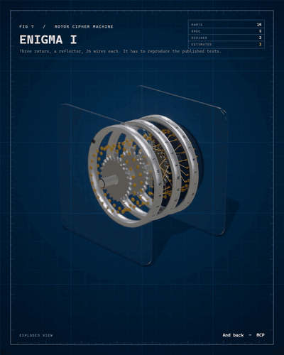
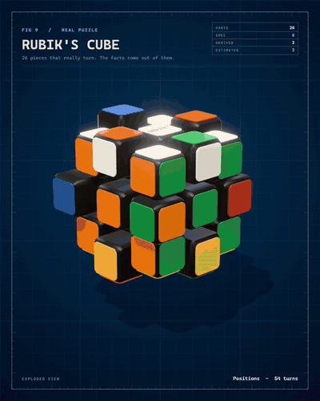
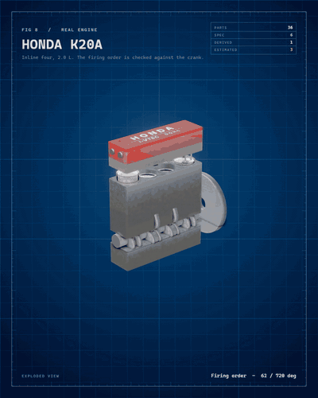
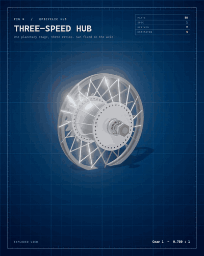

<h1 align="center">mechanism</h1>

<p align="center"><b>Build inspectable models from evidence. See what is known, estimated and tested.</b><br>
A skill for coding agents that researches a real product or machine, writes a spec where every number says where it came from,<br>
refuses to render when the numbers do not add up, and outputs a film, an interactive viewer and a 3D model.</p>

<p align="center">
  <a href="https://diegolopez0208.github.io/mechanism/"><b>Live page</b></a> &middot;
  <a href="https://diegolopez0208.github.io/mechanism/#touch">Try the viewers</a> &middot;
  <a href="#install">Install</a> &middot;
  <a href="#examples">Examples</a> &middot;
  <a href="#how-it-works">How it works</a>
</p>

<p align="center">
  
  
  
  
  <a href="https://www.claudepluginhub.com/plugins/diegolopez0208-mechanism?ref=badge"></a>
</p>

<p align="center"></p>
<p align="center">
  
  
  
</p>

## What it does

### Presentation methods and backgrounds

Choose a rendering engine independently of its background. **Studio** is the normal WebGL product film (assembly, lighting, materials and operation). **Workflow** is an independent Canvas2D factory/process engine with stations, conveyors and moving data carriers; it does not build or show the Studio object. **Paper** is an independent Canvas2D drafting engine with orthographic front/top/side drawings, progressive strokes, exploded construction and numbered details. It reuses model geometry as data, never a shaded Studio image.

```sh
node scripts/render.mjs examples/lock/index.html --method studio --background porcelain --length short --aspect 9:16 --encoder browser --out work/studio.mp4
node scripts/render.mjs examples/react/index.html --method workflow --background graphite --length short --aspect 9:16 --encoder browser --out work/workflow.mp4
node scripts/render.mjs examples/lock/index.html --method paper --background ivory --length short --aspect 9:16 --encoder browser --out work/paper.mp4
```

Methods: `studio`, `workflow`, `paper`. Backgrounds: `graphite`, `blueprint`, `porcelain`, `ivory` (all twelve combinations). Use the same names in `?method=paper&background=blueprint` or `presentation: { method: 'paper', background: 'ivory' }` in the spec. Query options override the spec. Old `style`/`theme` films retain their appearance when no presentation option is supplied. Studio has the existing orbit/explore viewer; Workflow/Paper use their own playback canvas even with `?explore`.

Studio renders 3D at 1.5x and downsamples to delivery resolution, retaining MSAA 4x (`stage.renderScale`: 1–2). Workflow/Paper do not create WebGL contexts: their graphics and typography are rasterized directly from vector paths using a deterministic CPU Canvas2D surface, with no 3D shading or temporal blur. Their short/normal/extended cuts are 30/60/90 seconds; Studio retains the object's original timing. Workflow's progress is illustrative, not measured latency. Paper's drawings are orthographic construction views, not to scale; estimates remain marked/dashed. Numeric evidence/verdict rules are unchanged. STL/GLB exports use Studio.

`boot.js` loads `kit/presentation.js`, `kit/workflow-engine.js` and `kit/paper-engine.js` after `core.js`. Hand-written script lists should include these explicitly. Configuration, planning, factory layout and orthographic projection helpers also run in Node/vm without a DOM. No dependency or build step is added. See [presentation validation](docs/presentations.md).

Ask your agent for an exploded view of something real: a machine, a chip, or **software** (a file format, a protocol, an algorithm's output). It does not draw what it can look up wrong:

1. **Researches.** Searches, opens datasheets and teardowns, downloads the pictures and looks at them, measures them.
2. **Writes a spec.** Parts with real dimensions, how they move, and the evidence behind every number.
3. **Runs the gate.** The model is run against what is published. A spec that does not add up is not rendered.
4. **Renders.** A 4:5 / 9:16 / 1:1 film with real recorded sound, a live viewer, and an STL / GLB.

| Label | Meaning |
|---|---|
| `SPEC` | Published by the maker or a datasheet. |
| `MEASURED` | Measured on an official photo, scale from a published size, error stated. |
| `DERIVED` | A formula plus a cross-check against another published number. |
| `ESTIMATED` | Nobody publishes it. Drawn dashed and said out loud. |

## The gate

```
$ node scripts/check-spec.mjs examples/rubik/spec.js
Rubik's Cube  (rubik)
parts: 26   claims: 9   sources: 2
cube: 26 cubies
  phase R U R' U' x 6: 6 (24 turns)
  phase Longest period: 1260 (10 turns)  published 1,260  ok
  phase Superflip: 20 moves (20 turns)  published 20 moves  ok
  phase Positions: 43,252,003,274,489,856,000 (0 turns)  published 43,252,003,274,489,856,000  ok

PASSES
```

The cube is 26 pieces that really turn, with no permutation tables. The numbers above are read off the pieces.
Break something and it says exactly what:

```
$ node scripts/check-spec.mjs examples/k20a/spec.js      # firing order changed to 1-2-3-4
ERROR  firing order 1-2-3-4: cylinder 3 would have to fire at 360 degrees and its crank throw is at 180 (not possible with that crankshaft)
ERROR  phase Firing order: the model gives 1-2-3-4 and the published one is 1-3-4-2

DOES NOT PASS: 3 error(s)
```

It fails (exit 1) when a number has no source, a DERIVED claim has no cross-check, a MEASURED one no error, an ESTIMATED one no reason; when two meshing gears are not at the centre distance their module and teeth demand; when a mode of operation does not give the ratio the maker publishes; when a cipher disagrees with a published test; when a firing order is impossible with the crank; when the superflip does not flip 12 edges.

## Examples

Every example is a film, a live viewer (`examples/<name>/index.html?explore`, add `&theme=night`) and a model.

| | What its model had to reproduce |
|---|---|
| [`enigma`](examples/enigma) | The Enigma I rotor stack. Wiring, notches and stepping are simulated and must match the published tests: `AAAAA` becomes `BDZGO`, with rings BBB `EWTYX`, and the middle rotor double-steps `ADU > ADV > AEW > BFX`. In the viewer you type on your keyboard. |
| [`rubik`](examples/rubik) | 26 cubies that really turn. The 20-move superflip flips all 12 edges, the longest period is 1,260 and the positions count 43,252,003,274,489,856,000. |
| [`k20a`](examples/k20a) | Honda K20A, inline four with 16 valves. A crank-slider with exact kinematics: displacement computed from bore and stroke (1,998 cc published) and the published firing order 1-3-4-2 must be possible with the crank. The connecting rod and valve timing are not published and are drawn dashed. |
| [`react`](examples/react) | **Software**, in motion: what a click does to a React page. The Counter component (JSX on a card), its output before and after the click, and the real DOM. A model written from the published reconciliation rules has to predict what the real React 18.3.1 touches: **1** of 8 DOM nodes (the text of the `<p>`), nothing created or removed. Measured with a MutationObserver in jsdom; the stranger test named React (90 and 92). |
| [`lock`](examples/lock) | A **pin tumbler lock**, cut open, with a Kwikset KW1 key (a real polygon with V cuts). The published keying table says key pin plus cut depth is .501 in for all six heights and the plug is about .498 in; the model must agree, the right key must put all five splits on the shear line, a key with one cut three steps off must leave a pin across it (the plug is blocked), and the code must obey the maximum adjacent cut rule. |
| [`winrar`](examples/winrar) | **Software**, doing its job: the three-book icon unpacking a file. WinRAR 7.23 packed a 119-character text into 49 bytes of DEFLATE; a decoder written only from RFC 1951 reads them one token at a time (literals and copies) and writes the text back. The CRC-32 must be the one WinRAR stored in the ZIP, and Node zlib and WinRAR itself must agree. |
| [`rar5`](examples/rar5) | **Software**, taken apart: the 87 bytes WinRAR 7.23 writes for a one-file archive, every one explained. A model written from the published RAR5 format must reproduce them byte for byte (the four CRC-32 values included), and the real `UnRAR.exe` must accept and extract the archive the model built. Change one byte and the gate fails. |
| [`mos6502`](examples/mos6502) | The 6502 in its 40-pin DIP. The gate counts the address and data pins on the pinout and compares them with the published 16-bit and 8-bit buses, computes the 64 KB address space and the 105 undefined opcodes, and measures the drawn leads against the DIP standard (2.54 mm pitch, 15.24 mm rows). Two sources have to agree; the body is estimated. |
| [`rtx4090`](examples/rtx4090) | GeForce RTX 4090 Founders Edition. TFLOPS (82.58 at boost, 73.07 at base), fillrates, the 1,008 GB/s of bandwidth and the 24 GB are each computed from the published cores, clocks, bus and data rate and must match. Every variable carries its claim; the memory packages are an estimated assumption and are drawn as one. The inside of the card is not published and is dashed. |
| [`hub`](examples/hub) | Three-speed planetary hub (Sturmey-Archer AW type). The running model gives 0.75, 1.00 and 1.333 against the published 75, 100 and 133 %. |
| [`switch`](examples/switch) | Cherry MX2A Red key switch: a press, not gears. The datasheet's three force points (30, 45, 100 cN) cannot come from one linear spring, and the film plots that instead of hiding it. |
| [`s25-vs-s26`](examples/s25-vs-s26) | Galaxy S25 Ultra against S26 Ultra at the same scale, measured on the official renders. Interiors are not drawn: no readable photo, and the film says so. |
| [`phones`](examples/phones) | POCO X8 Pro Max against Galaxy S26 Ultra, measured on official photos with OpenCV, interior from the maker's spare-parts photos. |
| [`rpi4`](examples/rpi4) | Raspberry Pi 4B from the official datasheet drawing. |
| [`backpressure`](examples/backpressure) | An idea from a repo built as a working machine. |

## Install

The one-line way, as a Claude Code plugin (Claude Code 2.1.275 or later):

```
/plugin install mechanism --marketplace DiegoLopez0208/mechanism
```

The skill then runs from the plugin folder, and your objects go in your own project.

Only the technical-drawing part (Mechanism Draft: dimensioned SVG drawings of flat parts at 1:1 or on an A4 sheet, vector Paper sheets and films, the evidence gate; without the 3D Studio film or Workflow; 1.6 MB):

```
/plugin install mechanism-draft@mechanism
```

Draft is not on `main` yet. Each stage is on its own development branch, and the marketplace must name the branch: `ecosystem-foundation` has Draft 0.1 (Paper sheets and films), `feature/draft-svg-03` adds the SVG export, `feature/draft-real-rpi4-04` the Raspberry Pi 4 example, `feature/draft-beta-hardening-05` the evidence classes and the fixes from the first stranger test. For example `/plugin marketplace add DiegoLopez0208/mechanism#feature/draft-real-rpi4-04`. See [`plugins/mechanism-draft/README.md`](plugins/mechanism-draft/README.md).

Or by hand, as a plain skill:

```bash
# macOS / Linux: a sparse clone (omit site/media and most history; tests include compact golden frames)
git clone --depth 1 --filter=blob:none --sparse https://github.com/DiegoLopez0208/mechanism ~/.claude/skills/mechanism
git -C ~/.claude/skills/mechanism sparse-checkout set kit scripts examples data tools tests
# Windows (PowerShell)
git clone --depth 1 --filter=blob:none --sparse https://github.com/DiegoLopez0208/mechanism $env:USERPROFILE\.claude\skills\mechanism
git -C $env:USERPROFILE\.claude\skills\mechanism sparse-checkout set kit scripts examples data tools tests
```

The skill can also be found with `npx skills add DiegoLopez0208/mechanism --list` (checked: it lists it). The kit, the scripts and the examples are plain files in this repo, so a clone is the safe way to get all of them.

Then ask: *"Use mechanism to model a mechanical keyboard switch from its published sources."* The agent researches, writes the spec, runs the gate and renders.

Needs Node 22+, Edge or Chrome (on Linux, Google Chrome stable), and `ffmpeg`; for rendering films, a GPU. `uv` is only used to measure photos. Nothing else to install.

## Use the toolkit directly

```bash
node scripts/new.mjs my-object --title "My object"          # a spec that already passes the gate
node scripts/check-spec.mjs examples/my-object/spec.js      # the gate
node scripts/probe.mjs "examples/my-object/index.html?explore" out/probe   # mouse-driven check of the viewer
node scripts/render.mjs examples/my-object/index.html --blur 3 --out out/my-object.mp4
node scripts/render.mjs examples/my-object/index.html --style studio --aspect 9:16 --out out/my-object-916.mp4    # dossier (default) | paper | night | studio
node scripts/render.mjs examples/my-object/index.html --from 13 --to 21 --out out/clip.mp4      # a clip
node scripts/render.mjs examples/my-object/index.html --export glb --e 1 --out out/my-object.mp4   # also: --export stl
node scripts/render.mjs examples/my-object/index.html --remux out/my-object.mp4                  # redo only the sound, in seconds
```

## How it works

Rendering supports `--encoder jpeg` (the compatibility default) and `--encoder browser` (software H.264 through WebCodecs, copied into MP4). The browser path automatically falls back to JPEG when VideoEncoder or H.264 is unavailable. Its bitrate scales with frame size, fps and part count; `--bitrate <bits/s>` overrides it. Both paths preserve stereo sound, two-pass loudness normalization and clip timing. The JPEG path now converts full-range BT.601 samples to limited-range BT.709 with accurate rounding; both paths carry colour metadata in the H.264 stream as well as the container.

Every browser script uses an isolated profile and an OS-selected CDP port. Render operations have a 30-second watchdog (`--timeout <seconds>`); the browser tree is stopped by its own PID and a stalled attempt is retried once from frame zero. `BROWSER_TIMEOUT_MS` configures the shared helper in the other tools. `CDP_PORT` is no longer used. For GPU-less CI, `BROWSER_SOFTWARE=1` explicitly selects SwiftShader.

Reproduce encoder quality outside published media with `node scripts/validate-render.mjs lock winrar --out <work>/quality --encoder browser`. It saves lossless references and decoded frames from modes, tours and every claims/sources/receipt panel, reports RGB error/bias and local-window SSIM, and leaves visual review marked pending. Add `--video-dir <work>/films` to compare already rendered full films at the same times. A metric is not a visual approval.

One spec in, everything out:

```
spec.js  ->  film (4:5, 9:16, 1:1; paper or night; stereo)
         ->  clips cut from the film
         ->  interactive viewer (orbit, explode, measure, run the mechanism)
         ->  STL and GLB of the model
```

A part, with the evidence it stands on:

```js
{ id: 'ring', kind: 'ring', p: { m: 0.8, z: 60, ro: 27.4, width: 8 }, mat: 'steel-dark',
  at: [0, 0, 0], body: 'ring', explode: [0, 0, -12], conf: 'derived', claims: ['teeth', 'formula'] }
```

| Mechanism | Declared as | The gate checks |
|---|---|---|
| Gear trains | `mechanism.links` + modes | Willis ratios, centre distances, tooth phases, published ratios |
| Presses and slides | `mechanism.press` | the force points against a linear spring |
| Rotor ciphers | `mechanism.enigma` | every published test, letter by letter, and reciprocity |
| Crank-slider engines | `mechanism.engine` | displacement, firing order possible with the crank, piston reaches the deck |
| Puzzles | `mechanism.cube` | period of a sequence, the superflip, the number of positions |
| Calculated figures | `mechanism.calc` | every published figure that comes out of others, from variables that each name their source |

The director builds the film by itself: staggered assembly, a cutaway while the mechanism runs, one mode at a time with its published number, the exploded view, a tour with a callout per part, re-assembly, and an evidence table with the sources.

### The look

Frames use a repeatable GTAO denoiser texture. The vendored GTAO pass does not rotate its noise every frame; its original simplex texture was randomized when a stage was created. The texture factory is now seeded without changing the AO settings or the application's randomness. Tiny GPU raster/compositing differences can still affect edge samples; the tests bound them rather than claiming every full-resolution PNG is byte-identical.

`npm test` includes four visual golden frames per example (mode, exploded view, claims and receipt), plus controls that deliberately introduce text overflow and a floating decor part. The lossless references are zlib-compressed 360x450 RGB, with separate Windows/Linux sets to account for native fonts. Compare with `node scripts/visual-regression.mjs`; intentionally regenerate with `node scripts/visual-regression.mjs --update` (optional example names limit the set). Review the changed frames before accepting new goldens. CI only compares them and never regenerates them. The regression threshold combines mean SSIM, the worst 8x8 tile and the fraction of changed tiles so a small displaced part is not hidden by the background. These sampled frames do not certify every instant of a film.

Every film is drawn as a **dossier**: a blue engineering drawing with a grid and ruler ticks, monospaced type, and a data block that counts how many numbers are SPEC, DERIVED and ESTIMATED. It is the look of evidence, not of a pretty explainer. The same engine can draw three other styles, chosen with `--style` (or `?style=` in the viewers) and defined as one table entry each in `MX.styles` (`kit/core.js`):

| Style | Look |
|---|---|
| `dossier` | The default. Blueprint grid, ruler, mono type, evidence block. |
| `paper` | Light paper, serif titles, corner-marked card. |
| `night` | The paper card in the dark. |
| `studio` | Black product-film set with a glow and rim light in the maker's colour (`brand: { accent }` in the spec). |

### The verdict is three-state, never a bare "pass"

The gate ends with `verdict: VERIFIED   8 reproduced, 1 estimated, 0 unchecked`. Only one thing earns VERIFIED: every published figure compared with the model matched, none is pending, and at least one of the checks is independent, meaning the sources of the published figure share nothing with the sources of the inputs the model computed it from. If everything matches but no check is independent, the state is `CONSISTENT`: the checks share their source with the inputs, or compare a drawn dimension with the very figure it was drawn from (a transcription check), or have inputs the gate cannot trace. A model that compares nothing says `NOTHING CHECKED` (a description, not a verification); a pending comparison says `INCOMPLETE`; any mismatch is `DOES NOT PASS`. Evidence classes (SPEC, USER, MEASURED, DERIVED, ESTIMATED) and the rule: [`docs/draft-evidence.md`](docs/draft-evidence.md). `node scripts/check-spec.mjs <spec> --json verdict.json` writes the report (verdict, errors, spec and kit SHA-256, Node version, date).

It also refuses what a template leaves behind: placeholder addresses (`example.com`, `.org`, `.net` and their subdomains, the reserved `.invalid`, `.test` and `.example`, `localhost`) and `TODO` in sources, claims or part names, non-positive or non-finite dimensions, a spec with no parts, a calculated variable with no claim, an expression that gives `undefined`/`NaN`/`Infinity`, an invalid tolerance and an ESTIMATED part with no reason. `node scripts/new.mjs` starts a draft that fails until it is filled in. Every one of those cases is a test in `tests/gate.test.mjs` (`npm test`) and runs in CI.

### Three lengths

The same spec renders three films: `--length short` (about 30 s: the plain sentence, the unpacking or the first checks, the explode, two parts, the receipt), `normal` (the default: verdict-first opening, every check, the tour, the evidence pages) and `extended` (longer checks, up to 12 parts in the tour). `node scripts/render.mjs examples/hub/index.html --length short --out out/hub-short.mp4`. A spec can say what its short cut keeps: `director: { short: { modes: ['unpack', 'crc'], tour: ['out25', 'bookP'] } }` (a cube or a cipher keeps every phase, because their state runs through all of them) and its default with `director.length`.

### Provenance per dimension, and a register

Part confidence (`SPEC`, `MEASURED`, `DERIVED`) describes its evidence, not verification of every drawn size. Part cards now say `SIZE NOT COMPARED` or `SIZE n/m COMPARED`; the register exposes each part's compared and unchecked dimensions. The gate also warns about computed values displayed without a published comparator, teeth outside meshing links, and unknown top-level spec or part keys (for example `cutawya`). These disclosures do not change the VERIFIED/CONSISTENT rules or turn a warning into a failed comparison.

A part can say where each of its sizes comes from, and the gate compares the drawn size with the source:

```js
params: { w: { value: 15.63, unit: 'mm', conf: 'spec', claim: 'size', tol: 0.005 },
          wall: { unit: 'mm', conf: 'estimated', why: 'the datasheet has no drawing' } }
```

A drawn 15.0 against a sourced 15.63 is an error; the compared dimensions count as reproduced figures; and a part whose headline class is stronger than its weakest dimension is reported as mixed (the card lists both). `node scripts/registry.mjs` runs the gate on every example and writes [`docs/registry.html`](docs/registry.html), `docs/registry.json` and an SVG badge per object (`docs/badges/<id>.svg`), all straight from the gate's output.

### Recognisable, not just correct

A model whose numbers all match can still look like nothing. A spec declares what a stranger should call the object and the features that make it that object, each tied to parts that exist:

```js
recognize: { object: 'Honda K20A inline-four engine',
  iconic: [{ text: 'red cam cover', parts: ['cover'] }, { text: 'four pistons', partsPrefix: 'piston' }] }
```

The gate refuses an iconic feature that is not built. Then the stranger test: `node scripts/stranger.mjs <example>` saves a still with no title, labels or panels (`?bare`), a model with no context is asked what it is, and the answer is recorded in `recognize.blind`. A wrong answer is a warning on the verdict, not a hidden one. Run on the shipped examples it found two that were not recognisable (the hub, and the first RAR5 film that was only hex cubes).

### Software

Software is verified the same way, against the real program: pick what it writes (a file format, a message, a result), make the real tool produce a sample, write a pure model from the published description, and let the gate demand that the model rebuilds the sample byte for byte and that the real tool accepts what the model built. `examples/rar5` does it for RAR5: `scripts/make-rar5-sample.mjs` runs `Rar.exe` and `UnRAR.exe`, the model is `kit/rar5.js`, and the evidence travels with the spec in `data.js`.

### Films open with a verdict

A film can open with the question and the published answers being checked one by one (`director.cold`), shows each part's sources as it is inspected, and closes with a receipt (VERIFIED or DOES NOT PASS) listing every figure compared.

### Brand identity

An object has to look like itself. The maker's wordmark, colours and finish are drawn with `decals` (type, rules and shapes on any face, with optional glow), never with logo files, and they are declared like any other number: a livery that no opened source shows is an `ESTIMATED` claim and says so. `director.hold` gives the finished, lettered object a beauty shot before the cutaway starts.

### Sound

Real recordings, not synthesis: keys, metal, glass, plastic and rubber impacts (CC0, see [THIRD_PARTY.md](THIRD_PARTY.md)), mapped per material and size. Tooth ticks are the real tooth passes of the running gears, and the engine fires in its real order.

### Repository

| Path | Role |
|---|---|
| `SKILL.md` | The skill: when to use it, the method, the rules. |
| `kit/parts.js` | Parametric parts with real dimensions: involute gears, rings, sprockets, bearings, springs, crankshafts, rods, pistons, valves, rotors, cubies. |
| `kit/kin.js`, `kit/enigma.js`, `kit/cube.js` | Gear-train kinematics (Willis), the Enigma I logic and the Rubik cube as 26 cubies. Pure: run in Node and are checked against published vectors. |
| `kit/spec-core.js`, `kit/spec.js` | Validate a spec; compile it to scene, director, panels and sound. |
| `kit/gl.js`, `kit/figure.js` | three.js stage (physical materials, glass, depth of field, ambient occlusion, bloom) and the figure engine. |
| `kit/sound.js`, `kit/samples.js` | Sound per material and size, from CC0 recordings. |
| `scripts/` | `check-spec`, `render`, `probe`, `new`, and the build scripts. |
| `examples/` | The objects above. |
| `docs/`, `index.html` | The landing page (its hero is the same parts running live in three.js). |

## Agent runs

Does it work without someone holding its hand? Two objects were given to fresh agents with only the skill and one sentence, under criteria written before the results (`docs/benchmark/criteria.md`):

| Object | Autonomy | Gate | Stranger test |
|--------|----------|------|---------------|
| 3.5-inch floppy disk, 1.44 MB (chosen by me) | complete, 18 min 51 s | VERIFIED, 15 checks | named it (one judge, 95 %) |
| Antikythera mechanism (asked for by a reader) | complete, 27 min | VERIFIED when it ran; CONSISTENT with today's gate (6 checks, none independent of its inputs, three of them through estimated gears) | did not name it ("a clock movement") |

Two runs are two data points, not a success rate; the agents were subagents with a clean context, not independent sessions, and the plan is 20 objects. The logs keep every failure and the toolkit problems the agents hit were fixed afterwards (the version each run used is written in its notes). Notes: `docs/benchmark/run-01-antikythera.md`, `docs/benchmark/run-02-floppy.md`. There is also a hand-edited Antikythera (`docs/benchmark/antikythera-refined/`), labelled as such, that is not part of the result.

## Limits, stated plainly

- Mechanisms so far: gear trains (one degree of freedom), presses and slides, rotor ciphers, crank-slider engines, the Rubik cube and calculated figures. No general linkages yet.
- The hub's power path per mode is simplified: pawls and clutch are not modelled, and the film says so.
- Interiors need photos or drawings. Without them they are estimated and dashed.
- A single photo gives no millimetres: it needs a published size, a ruler or a datasheet.
- **A GPU makes rendering fast; without one it is very slow.** On a laptop with a discrete GPU a normal film takes about 2 to 3 seconds per second of video and the 30 s cut about a minute (`--draft` gives a quick preview). On a machine with no GPU (software WebGL) one frame takes about 7 seconds, so a 30 s film would take over an hour: use `--still`, `lint-film.mjs` and the viewer there, and render elsewhere.
- **Platforms.** Developed on Windows. Tested on Ubuntu 24.04 (WSL2, Node 22, Chrome and ffmpeg installed from scratch, as a normal user): the partial-clone install, all the tests and gates, stills and the film lint work. Films were not rendered on Linux (no GPU there) and nothing was tried on macOS. The tests also run on Linux in CI.
- **VERIFIED means compared and consistent, not true.** The agent writes both the model and the published figure it is compared with. The gate does not know if a source is right; it now says when a check uses the same source that fed the model (the state is CONSISTENT, not VERIFIED, if none is independent: the pin tumbler lock is one) and warns about quantities typed in captions that nothing in the spec backs. It cannot tell if two independent sources are both wrong, or if one copies the other without saying so (`derives`).
- The sources can be wrong too. The spec keeps them next to each claim so you can check, and notes where a page refused to be read.

## Roadmap

bicycle drivetrain, and the next 18 objects of the agent test. The rule is the same for all: numbers that can be computed and checked against what is published.

## Inspiration

[Anatomy](https://github.com/wheresryan22/anatomy) showed that an agent skill can explain something by building it as an interactive physical object, and its "Fig N" card is where ours started. `mechanism` goes the other way: not ideas explained with a metaphor but real objects, with every number traced to a source, a gate that refuses to render when the model contradicts what is published, and films with sound and 3D files as outputs.

## License

MIT. three.js, Inter and Cormorant Garamond are bundled under their own licenses, and the sound samples are CC0: see [THIRD_PARTY.md](THIRD_PARTY.md). Product names identify the objects modelled and belong to their owners; their photos and datasheets are not redistributed.
